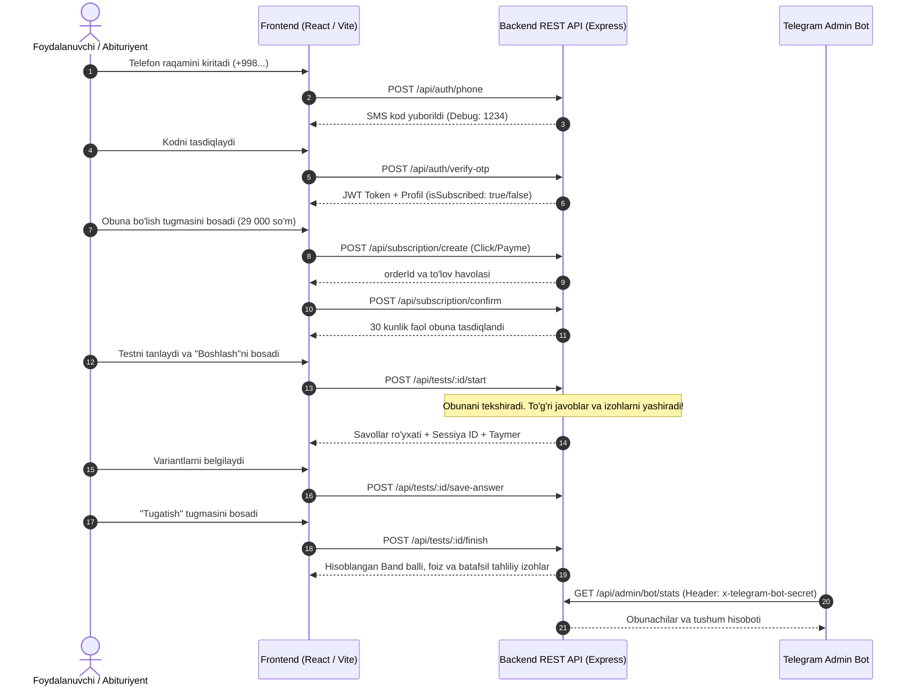

# 🏛️ MockLife Platformasi — Loyiha Strukturasi va Arxitekturasi

Ushbu hujjat **MockLife** (ingliz tili sinov testlari platformasi) loyihasining to'liq fayllar iyerarxiyasi, texnologik steki, komponentlar tuzilmasi va backend arxitekturasini bayon qiladi.

---

## 🚀 Texnologiyalar Steki

| Qatlam | Texnologiyalar | Vazifasi |
| :--- | :--- | :--- |
| **Frontend** | React 18, Vite, TypeScript, Tailwind CSS, Lucide Icons | Tezkor, mobile-first, 3 tilli (`uz`, `ru`, `en`) foydalanuvchi interfeysi |
| **Backend** | Node.js, Express, TypeScript, CORS, Dotenv | REST API, autentifikatsiya, obuna tekshiruvi, test sessiyalari |
| **Ma'lumotlar Bazasi** | Supabase (PostgreSQL) | Nomzodlar, obuna muddatlari va test natijalari saqlovchisi |
| **Admin Boshqaruvi** | Telegram Bot API (`x-telegram-bot-secret`) | Testlar yuklash, obunalarni faollashtirish, statistikani kuzatish |

---

## 📂 Fayllar va Papkalar Strukturasi (Tree)

```text
IELTIX-main/
│
├── docs/                                # Loyiha hujjatlari va spetsifikatsiyalari
│   └── api.md                           # To'liq REST API shartnomasi (Contract)
│
├── dizayn me/                           # Dizayn manbalari va referenslar
│   ├── Mock Test Landing.html           # Referens HTML va CSS
│   ├── Mock Test Landing.pdf            # PDF vizual maketi
│   ├── image copy 34.png                # Til tanlash va 9.0 dafna gulchambari referensi
│   └── ... (boshqa skrinshotlar)
│
├── supabase_schema.sql                  # PostgreSQL / Supabase jadvallar sxemasi
├── deploy.sh                            # Serverga avtomatlashtirilgan joylash skripti
├── start_server.bat                     # Windows uchun serverni ishga tushiruvchi skript
├── PROJECT_STRUCTURE.md                 # Loyihaning to'liq strukturasi hujjati
│
└── IELTIX_platform/                     # Asosiy ilova papkasi
    │
    ├── frontend/                        # REACT + VITE FRONTEND (Port: 5173)
    │   ├── public/                      # Statik resurslar
    │   │   └── image-copy-34.png        # Tillar va brend referens rasmi
    │   │
    │   ├── src/
    │   │   ├── components/              # Modulli UI komponentlar
    │   │   │   ├── Navbar.tsx           # Logo, menyu, 3-tilli dropdown, Kirish, BOSHLASH
    │   │   │   ├── Hero.tsx             # 9.0 dafna gulchambari, katta sarlavha, 2 ta CTA, statistika
    │   │   │   ├── ResultsBlock.tsx     # 4 ta video/natija kartasi va chaqiriq tugmasi
    │   │   │   ├── PlatformPreview.tsx  # Tab-pills, brauzer mockup, sidebar, test kartalari
    │   │   │   ├── ReviewsBlock.tsx     # 4.8 reyting nishoni, 3 ta sharh kartasi
    │   │   │   ├── PricingBlock.tsx     # 29 000 so'm/oylik obuna kartasi, imkoniyatlar
    │   │   │   ├── FaqBlock.tsx         # Akkordeon ko'rinishidagi savol-javoblar
    │   │   │   ├── Footer.tsx           # MockLife rekvizitlari, yo'nalish eslatmasi
    │   │   │   └── MockTestModal.tsx    # Jonli test yechish, orqaga sanovchi taymer va natija
    │   │   │
    │   │   ├── config/
    │   │   │   └── api.ts               # Backend REST API konfiguratsiyasi va apiClient
    │   │   │
    │   │   ├── i18n/
    │   │   │   └── LanguageContext.tsx  # 3 ta til (uz, ru, en) lug'ati va holat boshqaruvi
    │   │   │
    │   │   ├── App.tsx                  # Asosiy sahifa yig'ilishi, obuna va kirish modallari
    │   │   ├── main.tsx                 # React DOM mount nuqtasi
    │   │   ├── index.css                # Tailwind CSS va asosiy tipografiya
    │   │   └── vite-env.d.ts            # Vite TypeScript muhit tiplari
    │   │
    │   ├── index.html                   # Unbounded va Nunito shriftlari ulangan HTML
    │   ├── tailwind.config.js           # Brend ranglari, radiusi va soyalari konfiguratsiyasi
    │   ├── tsconfig.json                # Frontend TypeScript konfiguratsiyasi
    │   ├── vite.config.ts               # Vite server konfiguratsiyasi
    │   └── package.json                 # Frontend kutubxonalari
    │
    └── backend/                         # EXPRESS + NODE.JS BACKEND (Port: 5000)
        ├── src/
        │   ├── data/
        │   │   └── mockData.ts          # Standart testlar, savollar, profil va lug'at bazasi
        │   │
        │   ├── routes/
        │   │   └── api.ts               # Barcha REST API marshrutlari va biznes mantiq
        │   │
        │   ├── services/
        │   │   ├── aiExaminerService.ts # Speaking AI modulini baholash servisi
        │   │   ├── writingEvaluatorService.ts # Writing insho tahlili servisi
        │   │   ├── vocabService.ts      # Lug'at saqlash va kontekst qidirish servisi
        │   │   └── supabaseClient.ts    # Supabase PostgreSQL mijoz obyekti
        │   │
        │   ├── types/
        │   │   └── index.ts             # Backend TypeScript interfeyslari va tiplari
        │   │
        │   └── server.ts                # Express ilova sozlamalari, CORS, middleware, listen
        │
        ├── .env                         # Maxfiy kalitlar (JWT, Bot Secret, Supabase, CORS)
        ├── .env.example                 # Muhit o'zgaruvchilari namunasi
        ├── tsconfig.json                # Backend TypeScript konfiguratsiyasi
        └── package.json                 # Backend bog'liqliklari
```

---

## 🧩 Komponentlar va Modullar Vazifalari

### 1. Frontend (`IELTIX_platform/frontend`)
* **`src/components/Navbar.tsx`**:
  * Yuqoridagi tillar xabarnoma paneli ("Saytning rus va ingliz tillaridagi talqini ham mavjud").
  * Brend logotipi: `•• MockLife`.
  * Globus belgili 3 ta tilni almashtiruvchi suzuvchi menyu (`🌐 EN` / `🌐 RU` / `🌐 O'Z`).
  * `Kirish` tugmasi va `BOSHLASH →` qizil-marjon pill tugmasi.
* **`src/components/Hero.tsx`**:
  * Markazda tilla rangli bug'doy/dafna gulchambari bilan o'ralgan **`9.0`** nishoni.
  * H1 sarlavhasi: *"Ingliz tilidan kerakli balni birinchi urinishda oling"*.
  * Ikkita harakat tugmasi: `TAYYORLANISHNI BOSHLASH →` va `PLATFORMA`.
  * 3 ta hisoblagich: `[N]+` Ishlangan testlar, `[N]+` O'quvchilar, `24/7` Kirish.
* **`src/components/PlatformPreview.tsx`**:
  * 6 ta faol tab-pills (`Mock testlar`, `Reja`, `Batafsil izoh`, `Statistika`, `Lug'at`, `Imtihon rejimi`).
  * 3 nuqtali (qizil, sariq, yashil) zamonaviy brauzer oynasi maketi.
  * Testlar kartalari ustiga bosilganda real vaqtda jonli sinov imtihonini boshlash.
* **`src/components/MockTestModal.tsx`**:
  * Haqiqiy imtihon kabi chap tomonda reading matni, o'ng tomonda savollar va variantlar.
  * Orqaga hisoblovchi jonli taymer (60:00).
  * Javoblarni backendga avto-saqlash.
  * Test yakunlanganda ball, aniqlik foizi va har bir savolga backenddan qaytgan tahliliy izohni ko'rsatish.
* **`src/i18n/LanguageContext.tsx`**:
  * O'zbekcha (`uz`), Ruscha (`ru`) va Inglizcha (`en`) tillaridagi barcha matnlarni markazlashgan boshqaruvi.

---

### 2. Backend (`IELTIX_platform/backend`)
* **`src/routes/api.ts`**:
  * **Autentifikatsiya:** `POST /api/auth/phone` va `POST /api/auth/verify-otp`.
  * **Obuna (29 000 so'm/oy):** `GET /api/subscription/plan`, `POST /api/subscription/create`, `POST /api/subscription/confirm`.
  * **Test Sessiyalari:**
    * `POST /api/tests/:id/start`: Obunani tekshiradi. Obunasi yo'qlarga testni yopadi (faqat tanishuv savollari ochiq). To'g'ri javoblarni test davomida foydalanuvchiga bildirmasdan yashiradi.
    * `POST /api/tests/:id/save-answer`: Javoblarni xotirada avto-saqlaydi.
    * `POST /api/tests/:id/finish`: Javoblarni tekshirib, ball va har bir savolga batafsil tushuntirishlarni taqdim etadi.
  * **Telegram Admin Bot:** `x-telegram-bot-secret` orqali himoyalangan boshqaruv yo'llari:
    * `GET /api/admin/bot/stats` — Tushum va obunachilar statistikasi.
    * `POST /api/admin/bot/subscription/grant` — Foydalanuvchiga qo'lda 30 kunlik obuna berish.
    * `POST /api/admin/bot/tests/upload` — Yangi test savollarini yuklash.

---

## 🔄 Ma'lumotlar Oqimi (Data Flow)



---

## 🛠️ Loyihani Ishga Tushirish

### 1. Backend'ni ishga tushirish (Port: 5000)
```bash
cd IELTIX_platform/backend
npm install
npm run build
npm run start
```
*Server manzili: `http://localhost:5000`*

### 2. Frontend'ni ishga tushirish (Port: 5173)
```bash
cd IELTIX_platform/frontend
npm install
npm run dev -- --host --port 5173
```
*Sayt manzili: `http://localhost:5173`*

